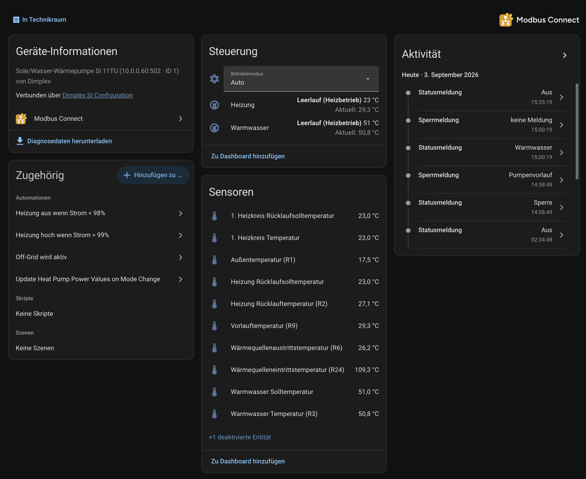
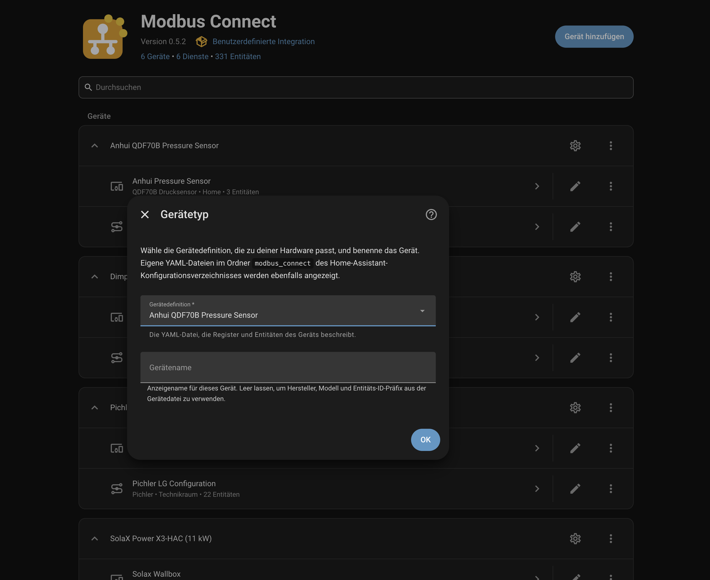

<picture>
  <source media="(prefers-color-scheme: dark)" srcset="custom_components/modbus_connect/brand/dark_logo@2x.png">
  
</picture>

Modbus Connect is a Home Assistant custom integration for Modbus devices. It
connects through a Modbus TCP gateway, a transparent RTU-over-TCP bridge, or a
serial (RS-485/RS-232) adapter attached to the Home Assistant machine.

Each device is described by a YAML *device file* that maps its registers to
Home Assistant entities. A few device files are bundled; for any other device
you write one yourself.

  
   <em>The device page of a Dimplex heat pump, set up from its bundled device file.</em>

## Features

- Sensors, binary sensors, numbers, selects, switches, buttons, texts, times
  and valves from single registers; climate, fan, cover and light entities
  composed from several registers.
- Registers are read in merged blocks rather than one request per entity.
- [Entity groups](docs/entity_groups.md): parts of a device can be switched on
  and off; entities that are off are not polled.
- A register the device refuses is taken out of polling and reported as a
  repair issue; the other entities keep working.
- Several devices can share one gateway or serial adapter.
- Your own [device files](docs/writing_a_device_file.md) are loaded from the
  Home Assistant configuration folder. A browser-based register scanner in
  this repository helps with writing them.

## Requirements

- Home Assistant **2026.11** or newer.
- A Modbus device reachable over the network, or through a serial adapter that
  Home Assistant can see.

## Supported devices

These six device files have been tested on real hardware and are maintained
here:

| Manufacturer | Model |
| --- | --- |
| Anhui | QDF70B pressure sensor |
| Dimplex | SI 11TU brine/water heat pump |
| Pichler | LG 150 – LG 250 ventilation unit |
| Pichler | LG 350 – LG 450 ventilation unit |
| SolaX Power | X3-Hybrid G4 inverter |
| SolaX Power | X3-HAC 11 kW EV charger |

**Untested device files.** A further 18 files are bundled that were converted
automatically from community files of another integration. Nobody here has
run them against the hardware, so they may be incomplete or wrong; they are
not counted as supported. Home Assistant shows them with *(untested)* after
the model. They cover devices from Eastron, ebyte, Finder, Fröling, Growatt,
Husdata, Salda, Schneider Electric, Varmann and Waveshare — see the
[device list](docs/supported_devices.md). Reports from people who own one of
these devices are welcome.

## Installation

**With HACS (recommended)**

1. In HACS, open the three-dot menu, choose **Custom repositories**, and add
   `https://github.com/dmatscheko/modbus_connect` with type **Integration** —
   or click
   .
2. Install **Modbus Connect** and restart Home Assistant.

**Manually**

Copy the `custom_components/modbus_connect/` folder into
`<ha_config>/custom_components/` and restart Home Assistant.

## Setup

Add the integration once per Modbus device: **Settings → Devices & services →
Add integration → Modbus Connect**, or click
.

1. **Device type** — pick the definition that matches your hardware and give
   the device a name. Entries marked *(untested)* are
   [unverified conversions](#supported-devices).
2. **Connection type** — *Network* (Modbus TCP, or RTU over TCP for transparent
   bridges) or *Serial port* (an adapter attached to the Home Assistant
   machine).
3. **Connection** — enter the host and port, or the serial port and its line
   settings. The Modbus device ID and the entity-ID prefix are prefilled from
   the device definition.

Before the entry is created, the integration reads from the device once, so a
wrong address or Modbus device ID is reported in the dialog.

  
   <em>Step 1: pick the device definition and name the device.</em>

Notes:

- **Changing things later.** *Reconfigure* (three-dot menu of the entry)
  changes the device definition, name or connection without removing the
  entry. The entry's options (gear icon) set a *minimum* update interval — it
  can only slow polling down.
- **Entity IDs** are assigned when an entity is first created, so changing the
  prefix later does not rename existing entities.
- **Showing more or fewer entities.** A device file that uses entity groups
  gets one switch per group on the device's companion *Configuration* device —
  see [entity groups](docs/entity_groups.md).

## Documentation

| Topic | Page |
| --- | --- |
| Tested devices and untested device files | [Supported devices](docs/supported_devices.md) |
| Showing and hiding parts of a device | [Entity groups](docs/entity_groups.md) |
| Energy Dashboard wiring, automation examples | [Examples](docs/examples.md) |
| Connection problems, unavailable entities, wrong values | [Troubleshooting](docs/troubleshooting.md) |
| Polling, writes, read-health sensors | [How it works](docs/how_it_works.md) |
| Adding a device that is not bundled | [Writing a device file](docs/writing_a_device_file.md) |
| Every key of the device-file format | [Device file reference](docs/device_files.md) |
| Contributing a device file or code | [Contributing](CONTRIBUTING.md) · [Development](docs/development.md) |

All pages are listed in the [documentation index](docs/README.md).

## Getting help

Start with [troubleshooting](docs/troubleshooting.md). If that does not solve
it, open an
[issue](https://github.com/dmatscheko/modbus_connect/issues/new/choose) and
attach the diagnostics file (device page → ⋮ → *Download diagnostics*).

## Removal

Remove the integration entry in **Settings → Devices & services** (this
deletes its entities and devices), then remove **Modbus Connect** in HACS — or
delete `custom_components/modbus_connect/` — and restart Home Assistant. Your
own device files in `<ha_config>/modbus_connect/` are never deleted
automatically.

## Credits

Modbus Connect is a ground-up rewrite of
[modbus_local_gateway](https://github.com/timlaing/modbus_local_gateway) by Tim
Laing — it can be installed side by side with it; the entities are independent
— and also draws on
[homeassistant-solax-modbus](https://github.com/wills106/homeassistant-solax-modbus).
Released under the [MIT License](LICENSE).
