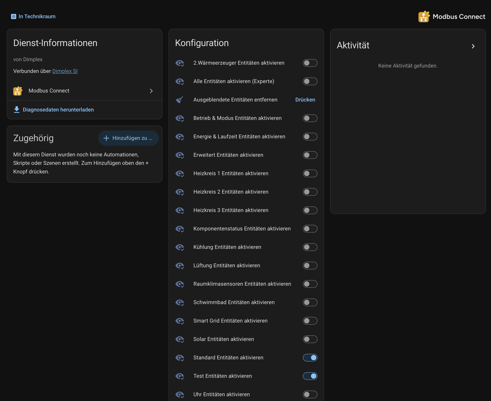

# Entity groups

Big devices expose far more settings and sensors than most people want. So a
device definition can sort its entities into **groups**, and you decide which
groups exist in Home Assistant — with ordinary switches, at any time.

  
   <em>The companion Configuration device: one switch per group, plus the expert switch and the cleanup button.</em>

## Where the switches are

Every device you add gets a companion device called **⟨name⟩ Configuration**
(the two link to each other on their device pages). It holds:

- one **Enable ⟨group⟩ entities** switch per group,
- on some devices an **Enable all entities (Expert)** switch,
- the **Remove hidden entities** button,
- and the read-health sensors described in [how it works](how_it_works.md#read-health).

Flip a switch and the integration reloads the device with the new selection.

## The groups of a bundled device

The bundled devices follow one convention, from least to most detail:

| Group | Shown | Meant for |
| --- | --- | --- |
| `basic` | always — it has no switch | the everyday essentials: main controls and headline sensors |
| `standard` | by default | common setpoints, secondary readings, totals |
| `advanced` | when you switch it on | the full detail: deep settings and per-component diagnostics |

Most entities also belong to a **feature group** such as *Battery*, *Grid* or
*Ventilation*, so you can switch a whole subsystem on at every level of detail.
An entity is shown when **any** of its groups is enabled.

The SolaX X3-Hybrid G4 file, for example, keeps its parallel-mode, EPS and
generator registers in groups of their own. They are the same opt-ins the
solax-modbus integration offers as checkboxes during setup — except that here
a switch creates the entities, and starts reading their registers, at any
time.

Which entities each switch reveals is listed per device on its *groups* page,
linked from the [supported devices](supported_devices.md) list.

## Enable all entities (Expert)

While this switch is on, the group selection is ignored and every entity of
the device exists. It is offered only where it adds something:

- the device has entities in no group at all — the expert tier that only this
  switch can reveal — or
- it has so many groups that flipping them one by one would be a chore.

## What "hidden" means

A hidden entity is not merely disabled:

- It stops being provided, and its registers **leave the read plan** — hiding
  entities makes polling lighter.
- Home Assistant greys it out but keeps its registry row, so its name, area and
  enabled state all come back when you enable the group again.
- **Remove hidden entities** deletes those greyed-out leftovers (including
  stale rows from an earlier device definition). It never touches an entity
  that is currently provided.

A device definition without groups has no switches; it always shows every
entity.

## For device-file authors

How to tag entities, name the switches and choose the default selection is in
the [device file reference](device_files.md#entity-groups).
